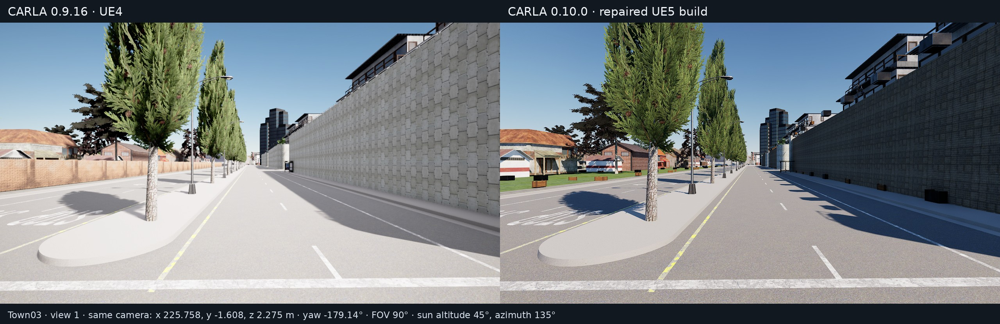

# Legacy towns on CARLA 0.10 / UE5.5

This branch makes the locally migrated legacy towns usable for rendered
inspection. It repairs black RGB captures, legacy sky initialization, large-map
origin handling, weather transitions, and scene-light shutdown. Weather and
lighting adaptations are opt-in. This is an experimental integration, not
visual parity with CARLA 0.9.16 or full-map qualification.

## Build and content

Use the CARLA UE5.5 engine and the existing CARLA source-build setup. From the
repository root, an incremental game build is:

```sh
"$CARLA_UNREAL_ENGINE_PATH/Engine/Build/BatchFiles/Linux/Build.sh" \
  CarlaUnreal Linux Development \
  -project="$PWD/Unreal/CarlaUnreal/CarlaUnreal.uproject" -game
```

Cook and stage the package through the normal CARLA packaging workflow after
changing content or packaging settings. `DefaultGame.ini` includes the migrated
map paths and stages the nested Town11/12/13/15 OpenDRIVE directories. A clean
checkout still needs the corresponding compatible map assets; this branch does
not distribute cooked maps or Unreal Engine binaries. Town08 and Town09 assets
were unavailable and are not included.

Do not overwrite a running server's executable. Keep the verified package
separate from any new build while inspecting changes.

## Launch and capture

The portable utilities live in `PythonAPI/util/legacy_maps`. They accept paths
and ports explicitly and do not depend on a particular machine or scheduler.
Use the Python client matching the server version.

```sh
python3 PythonAPI/util/legacy_maps/launch.py Town03_Opt \
  --package-root /path/to/cooked/Linux \
  --graphics-adapter 0 --port 2000 \
  -carla-experimental-sky-fill=2

# In another terminal:
python3 PythonAPI/util/legacy_maps/capture.py \
  --port 2000 \
  --poses PythonAPI/util/legacy_maps/town03_poses.json \
  --output /path/to/new/captures
```

The graphics adapter argument is the **Vulkan** device index; CUDA/Slurm indices
can differ. The launcher supplies the cooked Blueprint loader override
`bForceDisableCookedDependencyDeferring=True`, disables hardware ray tracing,
and sets `r.LocalExposure 0`. These are the conditions used for the inspected
captures.

The camera utility saves the actual world-space camera transforms, server and
client versions, effective shared camera attributes, unsupported fields,
weather readback, and OpenDRIVE hash. It uses 1280×720 RGB, 90° FOV, a fixed
0.05-second simulation step, and 1200 warm-up ticks. Subsequent views settle for
300 ticks. A fixed hero vehicle keeps the relevant map area active; the camera
is independent of vehicle physics.

For a version comparison, run this utility against a 0.9.16 server and a 0.10.0
server using the **same poses file** and separate empty output directories.
It loads the requested map if needed, restores settings/weather after capture,
and refuses to overwrite an existing output. The bundled Town03 poses were
generated in 0.9.16. Some additional UE5 postprocess controls are absent from
0.9.16; matching shared settings does not make native rendering identical.

## Rendering controls

`launch.py` enables the modern sky/weather bridge by default. Use
`--native-sky` only for the limited native sun/height-fog fallback: it does not
support rain, cloud, wetness, wind, or dust rendering.

| Purpose | Additional server arguments | Limits |
| --- | --- | --- |
| Shaded detail | `-carla-experimental-sky-fill=2` | Retains directional shadows; not calibrated photometry. |
| Legacy surface wetness | `-carla-wetness-bridge -carla-wetness-scale=100` | The inspected materials use percent units internally. Values derive from the current weather request, including repeated updates. |
| Limit puddle pooling | `-carla-puddles-scale=0.25` | Mitigation only. A material slope mask and recook are still needed to prevent puddles on vertical surfaces. |
| Volumetric fog | `-carla-experimental-volumetric-fog` | Approximation; optional `-carla-volumetric-fog-distance=200` is in metres. |
| Night illumination | `-carla-night-lighting -carla-night-street-scale=0.05 -carla-night-moon-lux=0.25 -carla-night-sky-intensity=0.08` | Fixed-altitude moon approximation; original street-light state/intensity is restored in daylight. |
| Vehicle night lighting | `-carla-night-headlamp-fallback -carla-night-vehicle-lights` with night illumination | Paired 300-lumen spotlights; not automotive cutoff/IES calibration. |
| Rain isolation | `-carla-rain-no-lens`, optionally `-carla-rain-hide-particles` | Diagnostic A/B controls. Authored rain already produces world-space particles. |
| Material diagnostics | `-carla-material-weather-diagnostics` | Logs applied material values and authored precipitation state. |
| Sky diagnostics | `-carla-weather-diagnostics` | Logs sky/weather components after application. |

The rejected replacement-rain emitter has been removed. The remaining
`-carla-experimental-dust-material -carla-dust-material-scale=100` control exposes
a stationary screen overlay, not an airborne dust storm.

## Traffic Manager cache mismatch

Town03's existing binary Traffic Manager cache described a different road
network from the loaded OpenDRIVE: 7,936 of 8,877 cached waypoints were invalid.
The native loader dereferenced invalid waypoint pointers during initialization.
Clearing the default client cache alone downloaded the same incompatible file.

The private-cache helper regenerates from the active map and checks every
waypoint and link before Traffic Manager reads it:

```python
# Run with PythonAPI/util/legacy_maps on sys.path.
from pathlib import Path
from tm_cache import prepare

evidence = prepare(client, client.get_world().get_map(), Path("new-run"))
traffic_manager = client.get_trafficmanager(8000)
```

The validated replacement had 5,059 waypoints and zero invalid references.
`prepare` selects a unique process-local cache, leaves shared/package caches
untouched, and records input/output hashes. This is a workflow workaround;
the native cache loader itself is not repaired here.

## Validation and known gaps

Before publication cleanup, all 13 available map samples completed 60-second
vehicle recordings at 1280×720 and 20 fps: Town10HD_Opt and Mine_01 as native
references, plus Town01–07_Opt, Town11, Town12, Town13 and Town15. Each selected
route covered 404–489 m with zero reported collision events. All videos decoded
to 1200 frames and passed coarse brightness checks; first/middle/last images
were separately inspected. Traffic lights/signs were ignored for these scenic
recordings, so these results are not traffic-policy validation.

Town03 was also captured in actual CARLA 0.9.16 and repaired 0.10.0 runtimes.
All three camera transforms matched exactly, the OpenDRIVE SHA256 was identical,
and shared camera attributes matched. This view illustrates remaining visual
differences:



Observed limitations remain:

- Town03 has missing roadside fence sections, different wall materials, and
  floating-looking box props. Town06/07 also show misplaced-looking props.
- Town07's first route stalled at a static obstruction. The selected route
  avoids it; the content defect was not repaired.
- Town15 has glossy sidewalks under a dry weather request. The material cause
  has not been established.
- Deep shadows remain dark in some maps. Town11's sampled route is sparse and
  does not establish environmental asset completeness.
- Maximum deposits pool on vertical walls. Dust, moon and headlamp behavior
  retain the limitations above.
- Segmentation remains a separate, deferred engine experiment; no Unreal Engine
  source patch is included in this publication.

The source regressions have dedicated automation tests:

```text
Carla.ActorAttributes.RGBColorIsOpaque
Carla.Lights.SceneLightCanTurnOff
```

Run them in a Development runtime with
`-ExecCmds="Automation RunTests Carla.ActorAttributes.RGBColorIsOpaque+Carla.Lights.SceneLightCanTurnOff"`
and `-TestExit="Automation Test Queue Empty"`. In this Linux engine, `TestExit`
forces shutdown with process status 1; inspect each named test's completion
record rather than treating that status as a test result.

The publication checks also rebuild the game and inspect repeated wetness/puddle
updates and clear-weather recovery in the rendered runtime.
[Validation results](legacy_maps_validation.json) distinguish those checks from
the earlier gallery recordings.
